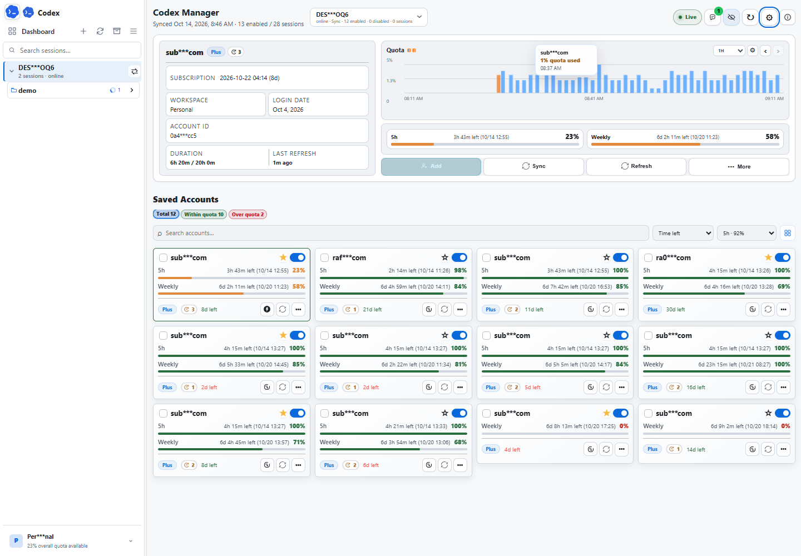
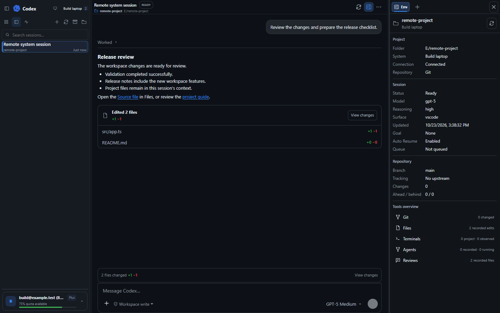
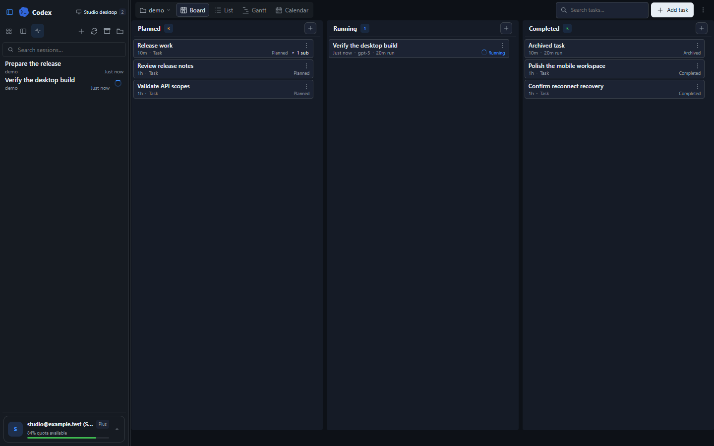
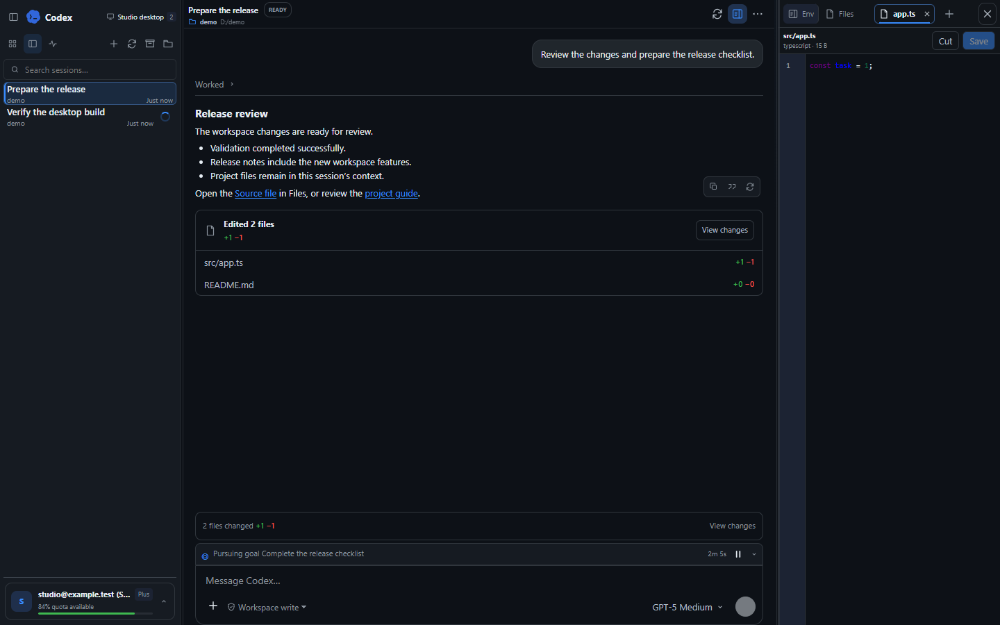
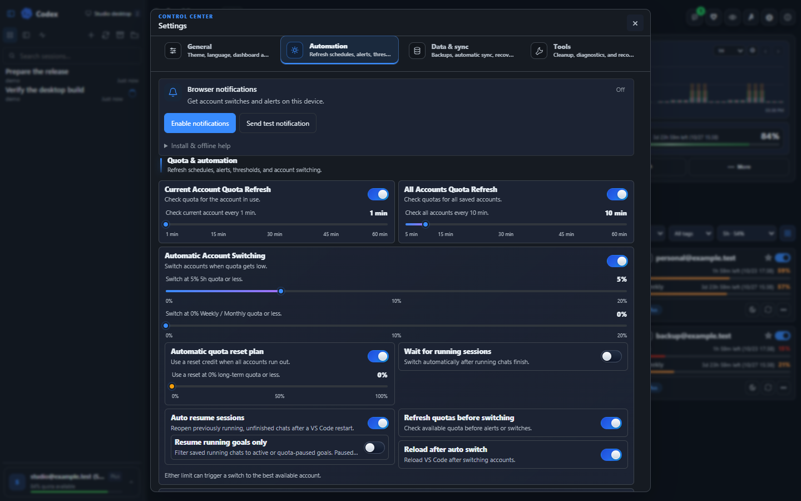
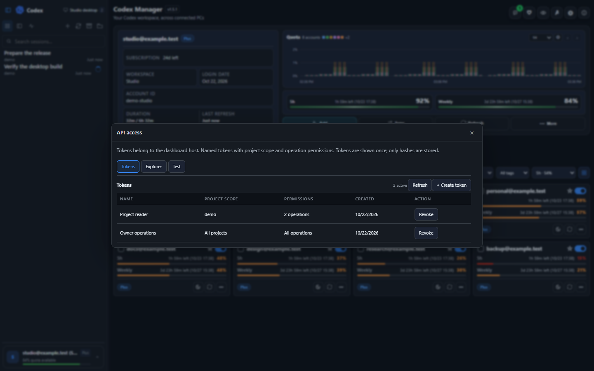
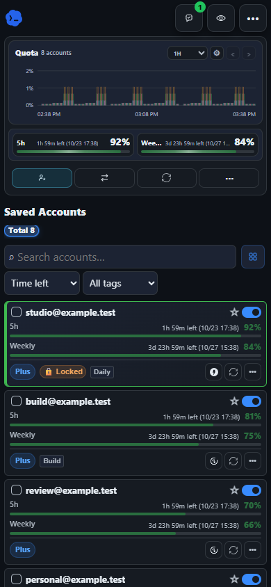
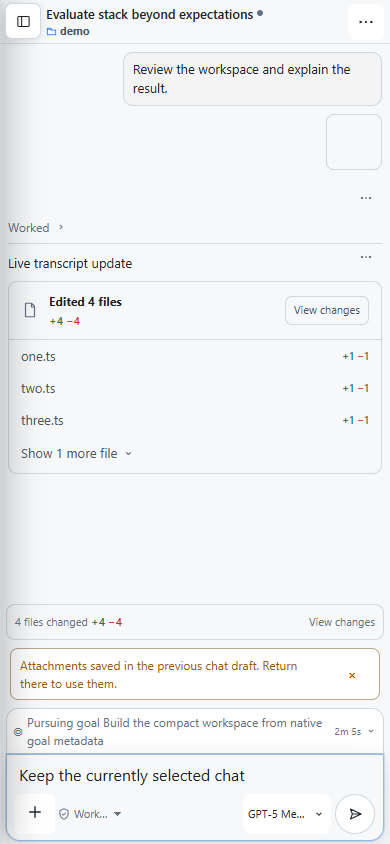

# Codex Manager

**Manage Codex on all your connected PCs from one browser.**

Follow live sessions, control remote work, edit project files, review Git changes, and use terminals from desktop or mobile. Codex Manager brings accounts, quota, project boards, and **Auto Resume** into one local-first VS Code extension and secure browser dashboard.

Auto Resume restores eligible unfinished parent sessions after a VS Code restart when Auto Switch is enabled. Completed conversations stay completed, and explicitly paused goals stay paused.

It is an independent, community project. It is not an official OpenAI product.

## What it provides

| Area | What you can do |
| --- | --- |
| Accounts and quota | Add OAuth accounts, import `auth.json`, restore backups, compare 5-hour/weekly/review usage, and see reset times and history. |
| Switching and automation | Switch manually or by quota thresholds, wait for every running session before switching, resume eligible conversations, and keep automatic switching safe when inspection is unavailable. |
| Sessions and goals | See all running parent sessions across projects and PCs, keep list order stable, inspect transcripts, view native goals above the composer, start/stop/fork turns, and continue from another VS Code window. |
| Remote dashboard | Open the password-protected dashboard from any desktop or mobile browser through HTTPS and Cloudflare Tunnel. Live WebSocket updates, PC labels, session counts, account claims, and remote actions stay in one interface. |
| Sync and claims | Authenticate peer connections, sync encrypted account state, reserve only the current account on a PC, and show which PC owns a claim. VS Code Settings Sync remains the durable fallback. |
| Notifications and PWA | Receive major switches, reloads, failures, and completed sessions with the source system name; send a delivery test; install the dashboard as a PWA; and recover to an offline shell while the host is unavailable. |
| Sharing and workspace | Create expiring read-only conversation links with the workspace transcript and full tool activity, browse project files, review Git changes, run project terminals, and keep actions visibly successful, cancelled, or failed. |
| Project task management | Plan ideas and tasks, use Board, List, Gantt, and Calendar views, group session subtasks under top-level custom tasks, create prompted session subtasks, inspect recorded running time, follow live activity, review conversation files and recorded changes, and share a project with feature permissions and optional embedding. |
| Dashboard API | Create multiple named API tokens, restrict projects and operations, revoke access, explore actions, and test requests. API access is off by default. |
| Offline browser | Reload a saved dashboard, read cached task/session views, keep task drafts and comments, and resolve reconnect conflicts without replaying live-only actions. |
| Privacy and diagnostics | Keep credentials local, redact persistent logs, enforce bounded requests, and expose no account controls through a share link. |

Use the dashboard settings for feature descriptions and configuration defaults. Manual switches use valid saved credentials immediately; expired credentials require successful renewal, with the same request retained for up to 30 seconds. Short auth commits serialize safely for up to two seconds. Optional token rotation and shared confirmation stay in the background.

The API Test tab checks the supplied token before enabling requests, lists only its permitted operations, and fills its allowed host project. Responses are formatted JSON. Host account actions such as `refreshAll` require an all-project token granting that exact operation. A `403` means permission or project scope was denied; `503` means scope ownership or a folder is temporarily unavailable and no action started. Requests are sent once; verify current state before retrying a timed-out write.

## Support development

To donate, open [Xoom for Bangladesh (BDT)](https://www.xoom.com/en-us/usd/send-money/transfer?countryCode=BD&destinationCurrencyCode=BDT), sign in with your PayPal account, enter your donation amount (USD 11 suggested), choose **Mobile Wallet → bKash**, and send to **Codex Manager** at `01628301525`. Review Xoom’s fee and exchange rate before confirming.

## See it in action

Eight views in two rows. Click an image for the full-size screenshot. All identities and account data shown here are fictional.

<table>
<tr>
<td align="center" width="25%"><a href="media/docs-dashboard.png"></a><br><strong>Accounts and quota</strong></td>
<td align="center" width="25%"><a href="media/docs-remote.png"></a><br><strong>Remote PC workspace</strong></td>
<td align="center" width="25%"><a href="media/docs-board.png"></a><br><strong>Project boards</strong></td>
<td align="center" width="25%"><a href="media/docs-workspace.png"></a><br><strong>Files, Git and tools</strong></td>
</tr>
<tr>
<td align="center"><a href="media/docs-settings.png"></a><br><strong>Auto Resume</strong></td>
<td align="center"><a href="media/docs-api.png"></a><br><strong>Scoped API access</strong></td>
<td align="center"><a href="media/docs-mobile.png"></a><br><strong>Mobile dashboard</strong></td>
<td align="center"><a href="media/docs-session-mobile.png"></a><br><strong>Mobile workspace</strong></td>
</tr>
</table>

### Connect your PCs

1. Install Codex Manager on each PC and keep VS Code running for live sessions and workspace controls.
2. Enable **Web Dashboard** and **WS Cross System**, configure the same shared dashboard password, and use the same HTTPS dashboard domain on your PCs.
3. Open the dashboard in your browser and choose a PC in the sidebar. Its sessions, projects, and enabled accounts load in that system's context.
4. Use the workspace tabs for **Env, Files, Git, Reviews, Agents, and Terminal**. Chat file links open in the Files panel, keeping the conversation visible.

Selecting an exhausted or unverified account manually applies a **15-minute Auto Switch lock**. Use **More → Unlock** to resume sooner; expiry and unlocking recheck selection within five seconds, even with periodic quota refresh disabled. Selecting an account with available quota removes the lock. Auto Switch must remain enabled, and all quota, enablement, session-wait, and ownership checks still apply.

Click an account's **Locked** badge to open its **Unlock Auto Switch** action. Browser/PWA push also receives important events from connected PCs through the authenticated relay, retaining each event's system name. Recent notices replay once after reconnect within a five-minute window; the dashboard host must be running to deliver push to its registered browsers.

Enable **Auto Switch → Auto resume sessions** to recover eligible work after a restart. Live actions require the selected PC to be connected; offline views keep saved data visible, and write actions retain authorization and ownership checks.

## Requirements

- VS Code 1.101 or newer.
- Node.js 22.13 or newer for the optional detached relay.
- A working Codex installation and a writable `CODEX_HOME` (the default Codex location is used when `CODEX_HOME` is not set).
- Node.js 22.13 or newer when building and testing from source.
- A signed-in VS Code Settings Sync account for optional cross-PC claim checks.
- `cloudflared` only when publishing the browser dashboard outside the local machine.

## Install

### Marketplace

Install **Codex Manager** from the [Visual Studio Marketplace](https://marketplace.visualstudio.com/items?itemName=imskriaz.codex-manager).

### VSIX

Download a release VSIX, then run **Extensions: Install from VSIX...** in VS Code. From a terminal:

```bash
code --install-extension codex-manager-<version>.vsix
```

### Build from source

```bash
git clone https://github.com/imskriaz/codex-manager.git
cd codex-manager
npm ci
npm run compile
```

Press `F5` in VS Code to open an Extension Development Host. Use `npm test` and `npm run verify` before distributing a build. Packaging is intentionally not part of the normal setup flow; run `npm run package` only when you are preparing a VSIX.

## First run

Use an account's **More actions → Tags** to edit up to 10 labels. Tags appear beside subscription days in a single compact row, with additional tags summarized in a tooltip. **All tags** filters the account list; search also matches tag labels. Edits apply to the selected system and remain outside credential sharing.

The header eye icon controls masking. **More → Tags** manages the selected system's tags: search, filter accounts, rename/merge labels, remove a label, or enable/disable its accounts. Group actions show confirmation and preserve the accounts themselves; enablement retains credential and ownership checks. Partial failures and unconfirmed operations remain visible in the modal.

1. Open the Command Palette (`Ctrl+Shift+P` / `Cmd+Shift+P`).
2. Run **Codex Manager: Add Account via OAuth** and finish the browser login. For an already configured Codex installation, use **Import Current auth.json** instead.
3. Open the Codex Manager dashboard from the status-bar item or **Codex Manager: Show Quota Summary**.
4. Select an account and run **Switch Account**. The extension updates the machine-wide Codex `auth.json`; restart the Codex desktop app when prompted.
5. Use **Refresh Quota** after login or account changes. Enable scheduled refresh only if you want background requests.

Every user-started action ends with a visible success, warning, cancellation, or failure message. If an action fails, open **Codex Manager: Open Persistent Logs** and include the operation ID when reporting it.

## Behavior and recovery

Session cards offer **Hide from boards** without stopping or archiving the conversation. Use the board menu → **Hidden sessions** to search and restore them. This choice is saved per project on its system and applies to all board views and public project links. Existing downloaded copies cannot be recalled.

Action feedback uses brief success/info toasts (3 seconds); warnings and failures remain for 10 seconds. Background data reads stay quiet.

Token history retains its account name after account removal; the credentials are deleted and historical names follow the masking setting. Older anonymous history keeps a stable identity until its original label is available.

Manager automatically follows the latest valid Codex OAuth login: it adds missing accounts and updates existing credentials. Removing its saved Manager entry does not sign out of Codex, so the active login is added back automatically. If Codex changes the login during an import, the next sync reads the new login; importing never writes older credentials back to Codex. Temporary failures retry, and incomplete auth-file writes preserve the last saved credentials.

WS Cross System uses the shared dashboard password independently of account Sync and Claim. While the dashboard host starts or hands over its port, browsers show a compact starting screen, then an offline retry state after a bounded wait. Session counts refresh in the background and do not delay dashboard state. The PC reached by the configured HTTPS domain prepares the shared relay after a host-proof check; domain changes are reconciled automatically. Other PCs connect as clients. Account credential synchronization follows its separate settings.

Reopening or restoring the VS Code dashboard closes previous Manager tabs and creates one fresh panel. Other editors remain open; unsaved Manager tabs or a failed cleanup stop replacement with an error.

## Commands

Open the Command Palette and search for `Codex Manager`.

| Command | Use |
| --- | --- |
| Add Account via OAuth | Authorize and save a new account. |
| Import Current auth.json | Save the account currently used by Codex. |
| Switch Account | Write a saved account to the active Codex credential file. |
| Refresh Quota / Refresh All Quotas | Refresh one account or every enabled account. |
| Restore Accounts from Backup | Restore the extension’s native backup format. |
| Restore Accounts from auth.json | Import accounts from a Codex credential file. |
| Restore Accounts from Shared JSON | Import a JSON export created on another machine. |
| Remove Account | Delete a saved account after confirmation. |
| Open Details | Show account identity, subscription, quota, and usage history. |
| Open Codex Home | Open the configured `CODEX_HOME` folder. |
| Show Quota Summary | Open the VS Code dashboard. |
| Keyboard Shortcuts & Help | View dashboard shortcuts and help. |
| Open Latest Session in VS Code | Open the newest local CLI session. |
| Sync Cross-PC Claims Now | Synchronize encrypted account ownership claims using the shared password configured in General. |
| Open Persistent Logs | View the latest 1,000 redacted diagnostic records from SQLite. |

## Browser dashboard and Cloudflare

The browser dashboard is enabled by default and listens on `http://127.0.0.1:39875` when enabled. In the dashboard Settings:

1. Turn on **Web dashboard**.
2. Set the shared **Password** in General; remote dashboard login and optional cross-PC claim checks use that same password.
3. For a public HTTPS address, enable **WS Cross System**, enter the final URL (for example `https://codex.example.com`), and configure the tunnel to forward to `http://127.0.0.1:39875`.
4. The manager automatically prepares the relay on the system verified to host that tunnel. Other systems connect without preparing a detached host.

The **Tools** tab opens focused maintenance panels for archives, conversations, goals, and old shell snapshots. Review the selected system and affected items before confirming deletion. Search with Enter or the Search button. Progress arrives through bounded events; reopening a running operation or reconnecting checks its current status without polling. Use Refresh status if the host cannot stream updates. A missing start reply can be checked without resending cleanup. Inspection tools report missing projects, large conversations, and native database health without changing data. **System Log** stays in Data & sync; its console contains download and clear controls, and startup and recovery diagnostics use this same toggle. Switching logging off clears saved manager history and stops saving startup logs.

Read Cloudflare’s [Tunnel overview](https://developers.cloudflare.com/cloudflare-one/networks/connectors/cloudflare-tunnel/), [downloads](https://developers.cloudflare.com/cloudflare-one/networks/connectors/cloudflare-tunnel/downloads/), [remotely-managed tunnel guide](https://developers.cloudflare.com/cloudflare-one/networks/connectors/cloudflare-tunnel/get-started/create-remote-tunnel/), and [Quick Tunnels guide](https://developers.cloudflare.com/cloudflare-one/networks/connectors/cloudflare-tunnel/do-more-with-tunnels/trycloudflare/) first.

Cloudflare Tunnel exposes the dashboard’s HTTPS and secure WebSocket endpoints. It does **not** expose raw MQTT/TCP; devices that use MQTT still need a separately reachable broker. Install the same stable VSIX on every PC that should appear in the PC picker; the dashboard cannot discover a PC whose extension host is offline or running an older build.

### Remote and mobile workflow

1. Install Codex Manager on each PC and enable CLI integration where sessions should be visible.
2. Configure the same dashboard password and Cloudflare HTTPS domain on the participating PCs.
3. Open the dashboard on desktop or mobile. The PC picker shows online devices, their session totals, and the selected device’s account view.
4. Enable **Browser notifications** on each device if you want switch, reload, failure, completion, or action prompts delivered while the page is closed.
5. Use **Install app** or **Add to Home Screen** on mobile for a standalone PWA. The offline page preserves the shell and reconnects when the host returns; authenticated data and actions still require a live host.

The dashboard’s session count is based on parent conversations and native runtime state. Child-agent rows and retained idle writer handles are excluded, so the count represents turns that are actually running.

## Settings

All settings use the `codexManager.*` namespace. The dashboard explains each control and its configuration defaults.

Important combinations:

- **CLI integration** enables dashboard session discovery and controls. It does not perform automatic CLI resume.
- **Encrypted sync** uses authenticated peer WebSockets when available and VS Code Settings Sync as its durable cross-PC fallback. Use the same password value on each machine; the password is never uploaded by the extension.
- **Automatic switching** is on by default, with quota refresh before switching, reload, Auto Resume, quota reset and warnings enabled. The 5-hour quota always participates in switching and status-bar warnings.
- **WS Cross System** controls cross-PC WebSocket connections using the configured HTTPS origin. Manager prepares the detached relay only after verifying that the configured tunnel reaches this system. Local dashboard WebSockets work independently. The `cloudflared` process and DNS route are managed by you.
- A visible browser dashboard subscribes to its selected system: one initial load, then file-change updates without recurring session scans. Switching systems or hiding/closing the dashboard releases that subscription. Idle VS Code instances retain lightweight authenticated presence for discovery and account ownership. Update both PCs together for the signed subscription protocol.

## Privacy and security

- Account tokens remain in local VS Code SecretStorage and the Codex credential file. Password-encrypted recovery records are stored in `~/.codex/manager.sqlite`. They are not sent to a Codex Manager server.
- Account metadata, settings, session recovery, usage history, and other extension state share that SQLite database, using WAL and full synchronous commits. Existing state is migrated without deleting its source files. VS Code Settings remains the editing interface and stays synchronized with SQLite. Process locks, diagnostic logs, Codex-owned files, and browser offline caches keep their platform formats.
- Sync and Claim synchronizes encrypted account IDs and PC ownership claims through VS Code Settings Sync and authenticated peer connections. **Sync account logins** is a separate setting and defaults off, so account sessions and tokens stay local unless the user explicitly enables it. Usage, quota data, and schedules are never synchronized. Turning Sync and Claim off stops new reservations and releases this PC’s previous claims; an offline release is retained for retry. Claims owned by other PCs remain unchanged. Sync Cross-PC Claims Now forces a download/merge/upload pass for the enabled sync mode.
- Remote browsers authenticate with the password at login, then a session cookie authorizes the WebSocket upgrade. Incoming actions reject expired sessions or a changed password. PCs authenticate through signed shared-password proofs before actions are accepted; the raw password is not attached to every message. Direct loopback requests remain trusted local access.
- The browser dashboard is local-only until enabled. Never expose port `39875` without the shared password and HTTPS access control.
- Persistent logs redact tokens and account identifiers. Open **System Log** in **Data & sync** for live console history, filters, details, Download, and Clear. The console and download include up to 1,000 recent records within 512 KiB. Saved diagnostics additionally obey the configured retention and a 10,000-record or 32 MiB cap.
- Manager automatically expires expendable caches and confirmed deleted-session metadata, and reclaims database space in the background. Session catalogues and token points use individual SQLite rows; SQL filters cache metadata and log exports before loading data into memory. Shared read results use an indexed `manager_cache` table in `manager.sqlite`, capped at 128 entries / 16 MiB with 2 MiB entries and a 60-second maximum lifetime. Cache failures fall back to source data; completed results are not retained in a separate memory map. Accounts, credentials, settings, native Codex history, and pending recovery are preserved.
- Review the [MIT License](LICENSE) and only manage accounts you own or are authorized to use.

## Troubleshooting

- **No accounts appear after reinstall:** enter the same shared Password so Codex Manager can unlock the encrypted account records in `~/.codex/manager.sqlite`. Existing data under `~/.codex-manager` is migrated automatically and the old folder is removed only after verification. See [storage and migration](STORAGE.md).
- **Quota refresh fails:** run **Refresh Quota**, check your network/proxy settings, and inspect **Open Persistent Logs** for the operation ID.
- **Switch did not affect Codex:** close/restart the Codex desktop app or enable the extension’s app-restart setting. Verify the active `auth.json` in **Open Codex Home**.
- **Browser dashboard cannot connect:** confirm Web dashboard is enabled, the shared Password is configured in General, and the Cloudflare route points to `http://127.0.0.1:39875`.
- **Sessions are missing:** enable CLI integration, verify the Codex CLI installation, and confirm the Codex session index exists.

## Documentation map

- [`CHANGELOG.md`](CHANGELOG.md) — human-focused notes for the current release.

## License

Codex Manager is available under the [MIT License](LICENSE). The project was originally based on [codex-manager](https://github.com/wannanbigpig/codex-manager).

[PandaCode](https://github.com/aicodeking/pandacode) is a design reference for the workspace and task-board experience. Source reuse is subject to its [PandaCode License](https://github.com/aicodeking/pandacode/blob/main/LICENSE), which includes an additional attribution requirement for forks.


### Session-aware switching and current-account claims

Auto Resume captures verified running parent conversations across projects and restores saved unfinished work as persistent native Codex tabs. Interrupted or quota-limited work stays eligible only when a previous running snapshot recorded it. Before opening saved sessions, recovery rechecks archive, parent, completion, and goal state; archived conversations and successfully completed non-goal work are discarded. A finished turn does not finish an active goal: saved active or usage-limited goals continue through their official owner without adding a user message. Interrupted non-goal work receives “Continue if not completed”. Native starts require a confirmed turn ID; uncertain replies retain recovery without a duplicate request. A native completion event carrying a provider error remains unfinished work. Unavailable metadata retains recovery for retry without opening uncertain sessions. Idle goal history does not add sessions to recovery. Explicitly paused, completed, blocked, and budget-limited goals are excluded with either goal-only setting. A pause recorded as part of an interruption remains eligible for recovery when the user did not explicitly pause the goal. The goal-only toggle filters the saved running set to active or usage-limited goals. In the browser chat, use the goal's Pause or Resume icon to change it explicitly. Native running checks still report actual activity, so retained writer handles cannot block an account switch indefinitely.

Automatic token history is on by default and preserves an explicit Off preference. All-account quota polling and Settings Sync saves default to ten minutes; current-account polling stays at one minute. Workspace and the browser dashboard are enabled; API access, System Log and Wait for running sessions remain off by default. Desktop restart mode is automatic when desktop restart management is enabled. Existing saved preferences are preserved. Default switching thresholds remain 5% for the 5-hour quota and 0% for weekly/monthly quota.

**Wait for running sessions** under Automation delays Auto Switch and automatic resets until every local turn finishes. If session inspection fails or times out, automatic switching waits with a warning and retries. Manual account switching remains available immediately.

**Reserve all accounts** under Data & sync is off by default, so Sync and Claim reserves only the account currently selected on this PC and frees every other saved account. Turn it on to claim every enabled saved account. Configure the same shared HTTPS dashboard domain and password on every PC. Ownership is confirmed in the background after local account switches, releasing previous reservations before claiming the current account. Lost release replies replay the confirmed release; failed cleanup retries after reconnecting. Parallel window mode retains each live window's current account. Account cards show the owning PC.

Browser conversations show the saved native Codex goal above the composer, including its objective, state, and elapsed time. This remains available when the goal creation event has scrolled out of the message history.

### Browser notifications and PWA

In the browser dashboard, open General settings and choose **Enable notifications** on each device. Major account changes, warnings, failures, completed sessions, and available notification actions use background Web Push. Delivery requires the dashboard host and network to be available; subscriptions are local to that host and expire after 30 days unless renewed. Logging out revokes that login's subscriptions.

Notification titles start with the originating system name. Session notifications also keep the conversation title, so notifications from multiple systems are easy to distinguish.

Use **Install app** where available, or your browser's **Add to Home Screen** option. On iPhone and iPad, open the installed Home Screen app before enabling notifications. The offline recovery screen reconnects automatically after a host restart. Saved read views remain available offline after a successful visit. Live actions require an authenticated connection; notifications never automatically repeat an uncertain action.

Browser notification setup appears when an unsubscribed device opens the HTTPS dashboard. Choose **Enable notifications**, then allow the browser permission prompt. You can also use **Settings → General → Browser notifications**. Major Codex Manager notices in VS Code, including account switches and reloads, are mirrored to subscribed devices; delivery attempts run in parallel and are drained before managed reloads.

Choose **Send test notification** in those settings to test all subscribed devices. The result reports push-service acceptance and failures; confirm receipt on your phone, since the browser and OS control notification display.

Running counts, Auto Resume capture, and the wait-before-switch preference share session verification. Native runtime status overrides retained writer handles, so loaded idle conversations do not count as running. A manual Stop is durable and suppresses replay until the user resumes or sends a new message; provider capacity and other interruption failures remain eligible. New chat lists existing local Codex projects, and session positions remain stable through background refreshes.

Auto Resume opens official Codex conversation tabs directly and waits for their runtime before sending. There is no background attempt or separate window setting. Existing conversation tabs are reused, and already running work receives no extra prompt. Unverified readiness or an uncertain send keeps recovery pending. Manager proxies session actions through the official Codex app-server daemon and never starts a private app-server.

### Shared session checks

Session inspection is demand-driven. Overlapping consumers share bounded running-session snapshots and matching per-session status reads; cancelling one consumer does not cancel the others, while the last cancellation stops the scan.

| Consumer | Required condition | Check |
| --- | --- | --- |
| Wait for running sessions | Auto Switch and Wait for running sessions enabled | All local running session IDs |
| Auto Resume at managed reload | Auto Resume enabled | Recent verified running IDs (up to 30 seconds old), otherwise a fresh check; then goal filter |
| Auto Resume background save | Auto Resume enabled | Verified running parents and previously recorded interrupted work; saved on status changes and every 30 seconds |
| Auto Resume restore | Saved recovery exists and Auto Resume enabled | Saved IDs and goal filter |
| Running indicators and workspace lists | Dashboard/session view requests status | Per-session native/transcript status |
| Explicit session actions | A session command needs ownership | Per-session status |

Manual account switching and ownership renewal do not request session inspection. Turning Auto Resume off clears saved recovery once and stops future checks.

Browser Share creates an explicit read-only snapshot link. Anyone with its token can view the conversation messages without signing in; it grants no dashboard access. Links expire after 30 days. Create a replacement or use **Revoke shared link** to invalidate the previous link. The session-share endpoint can refresh available saved messages. Project sharing below provides separate feature permissions and optional submissions.


### Workspace inspector

The header's workspace-tools icon shows or hides the right sidebar. **Env** stays
first and cannot be closed; it summarizes the selected project, system, session,
repository, goal, Auto Resume and queue. **Git**, Files, Reviews, Agents and
Terminal are closable tabs. The **+** follows the open tabs and opens a floating
tool menu. Terminal profiles and terminal-close controls stay inside Terminal.
Session rows use a compact two-line layout, with the title above project
metadata and time. Goal and queue controls use slim rows above the composer.
Project-grouped sessions use one-line system/project headings and show status/time
under each title rather than repeating their parent context.
Narrow screens retain larger session touch targets. Env's tools overview includes
Git state, recorded file edits, unsaved drafts, observed terminals, and agent
counts/status, with direct access to recorded agents. Unavailable information is
marked explicitly; the overview does not scan every project file in the background.

Each project and system keeps its own tool tabs, commit draft and file edits. Git actions retain their pending outcome when a tab closes or the selected project changes. A late commit confirmation clears only the submitted draft, keeping newer edits.

**Terminal** uses xterm.js with a host-owned pseudoterminal. New shared terminals use the same shell process in VS Code and the workspace: ANSI colours, cursor movement, keyboard input, shell history, Ctrl+C, resize, find, copy, rename and split views. Reconnecting restores a bounded screen and scrollback; input is never cached, queued offline or replayed after an uncertain confirmation. An explicit control handoff protects concurrent browser views. Existing native terminals remain available through **Show in VS Code** because VS Code’s public API cannot attach their existing raw screen. Windows and macOS native binaries are bundled; other hosts use VS Code’s matching terminal backend when available and report unavailable support clearly.

**Git** groups Changes, History, Branches, Stashes and GitHub into compact views. Stage or unstage individual files/all changes, inspect diffs, commit staged work, fetch, pull with fast-forward checks, push, manage local branches, merge/abort and save/apply/pop/drop stashes. Destructive actions require review; stale repository views are rejected. Repository-wide actions require the repository root project. Git conflicts and uncertain outcomes remain visible for resolution.

**GitHub** reads the selected system’s canonical GitHub origin and uses that system’s VS Code sign-in or Git credential manager. Credentials never go to the browser. Browse paged pull requests, issues, workflow runs and releases; inspect comments, file patches, checks and job steps; create/comment/close/reopen items, submit reviews, merge a verified PR head, dispatch/cancel/rerun workflows, and create/publish/delete releases. Writes require confirmation and are not replayed automatically. Large reviews, full logs, artifacts and repository administration remain available through **Open on GitHub**. Scoped project API tokens cannot invoke the repository-wide Git/GitHub or terminal actions.

### Project Kanban and task details

**Task view**, beside Dashboard in the browser workspace, opens the selected project's **Idea, Planned, Running, Completed** board. Kanban is on by default and can be turned off in Settings. Choose a discovered project or add an existing project folder, including a closed worktree.

Each discovered parent session has one database task. Create custom tasks or ideas without starting Codex. Group a session beneath a custom task using **Parent task** and **Move under task**; **Move to board** makes the session standalone again. Custom tasks stay at the top level and cannot be nested. **Subtask** starts a new session beneath a custom task. Board moves change classification without starting, pausing, resuming or stopping Codex. Child agents remain session activity. Running descendants mark their parent as running; idle work alone does not complete a task.

Open a task or subtask in the right panel for **Activities**, **Files**, and **Changes**. Activities combine messages, tool calls, command output, reasoning, and provider failures. Older transcript pages remain reachable without loading an entire conversation at once. Files includes supported uploaded text snapshots, conversation images, and recorded edit paths; upload previews read the conversation snapshot rather than a same-named project file. Changes shows recorded edits and current project state. Archived sessions remain in **Completed** and are also available through the **Archive** filter. Comments support offline drafting. **Start in Codex** runs a saved Planned task and attaches its session as a subtask; an unconfirmed start requires review before another attempt.

In the **Running Sessions** flyout, use the Auto Resume toggle beside running and interrupted sessions. Explicitly queued sessions retain their priority control, including warnings that need review. Global Auto Resume supplies the default; a session can opt in or out independently. Auto Resume restores unfinished work at startup or reload; finishing a session during normal use does not trigger recovery. Queue priorities run in ascending order; equal priorities are dispatched together once other work finishes. Startup checks are limited to eight at a time; the existing 30-turn limit keeps excess sessions queued until capacity is released. Later priorities wait for active work. Each accepted queue request is consumed once; queue the session again to request another run. Unknown activity or an unconfirmed queue start waits for verification. Recovery rechecks completion immediately before starting and sends no continuation when the session has finished. Explicitly paused goals stay paused. Recording and scheduling run in the extension host even when no dashboard window is open; VS Code must remain running.

### Public projects and embedding

Choose **Share project** to open the permission modal. Task titles, prompts, stages, and subtask structure are shared by the link. Choose whether visitors may read activities, conversation files, or changes, add comments, or submit ideas. Public views use the workspace message renderer and open task details in a right panel. New project links default to **Never Expire**; optional limits of 1, 7, or 30 days remain available. Existing timed links keep their original expiry. **Revoke all project links** disables every link for that project. Server checks apply to direct API requests as well as the visible controls.

Public boards and activity update from scoped change events while visible. Hidden and offline pages release their live connections and refresh on return. Expiry and revocation close open views; pending older responses cannot restore them. Streams carry change notices, and every content read still checks the link's permissions.

Public attachment and image previews require **Conversation files** permission. Uploaded text is removed from public Activities message text and remains available through its permitted file preview. Unavailable attachments show a failure without reading an unrelated project path. Open image viewers survive live activity updates and close with their task or revoked link.

**Allow embedding** is separate and off by default. Enable it when creating a link to receive iframe code for another website. Embedded views have exactly the link's feature permissions and expiry. Shared links never grant account, terminal, session execution, or token administration access.

### API tokens, scopes, and requests

Enable **Dashboard API** in Settings, then open **API** from the account center or dashboard. The token table supports up to 32 named tokens. Open **Create token** to choose all projects or check up to 32 existing project folders and select operation permissions. **Check all permissions** checks individual operations so you can uncheck any afterward. Copy a newly created token immediately; only its hash is saved. Revoke individual tokens when access is no longer needed. Turning API access off disables every bearer token.

Use **Explorer** for the action catalogue and **Test** in the browser dashboard to send a request once. Reads and writes use the existing dashboard operations and their validation/confirmation requirements. Project tokens can access only their project's sessions and workspace; account administration, global settings, remote-system targets, and global terminal operations require an all-project token with the corresponding permission.

| Endpoint | Permission and behavior |
| --- | --- |
| `GET /api/state` | `state`; returns the dashboard, or only a scoped project. Multi-project tokens require `?projectPath=` with a granted folder. |
| `GET /api/schema` | Returns the token's permitted operation catalogue. |
| `POST /api/message` | Requires permission for the requested action; settings require `settings`. |

Send `Authorization: Bearer <token>`. For example:

```json
{
  "type": "dashboard:action",
  "requestId": "unique-request-id",
  "action": "getProjectBoard",
  "payload": { "projectPath": "/absolute/project/folder" }
}
```

API tokens use HTTP endpoints; they cannot open an unrestricted dashboard WebSocket. Project-scoped responses exclude other projects' session lists and account/credential payloads. Operation-only tokens covering all projects do not receive appended dashboard snapshots unless they also grant `state`. A timeout is an unconfirmed outcome: inspect current state before retrying a live operation.

### Offline cache and reconnect

After visiting the browser dashboard online, supported browsers cache its data-free shell and bounded read views. Offline reload shows saved data with a stale/offline indicator. New host state replaces cached views after reconnect. A worker update activates only after its required shell assets are saved; an incomplete update preserves the working worker. Older workers never substitute their cached bundle for an explicitly newer asset version. Browser storage access and available space depend on the browser; a storage failure is visible and leaves an open draft intact.

Switching systems restores recently viewed lists before paint while IndexedDB and the live connection refresh them. This temporary cache holds at most eight lists, each limited to 4 MB, and keeps device identities separate. Saved activity older than five seconds is unverified until live data arrives. Late responses cannot replace newer realtime list updates. Unchanged peer heartbeats do not rebuild native session views; disconnects retain saved content while marking the action route offline.

Browser account read views use separate IndexedDB records for each system, including the active PC. Local cache and draft keys use the stable system ID, so changing the domain host cannot mix PCs. Drafts from earlier builds without a verified owner stay saved and require explicit restoration or system assignment before syncing. Sessions and composer catalogues are cached by owner; only the selected system’s session list and remote accounts stay in the visible application state. Switching systems restores its saved view and immediately requests current data. A missing PC remains selected as offline rather than silently switching to local data. Heartbeats carry a compact session summary; partial summaries cannot delete saved catalogue rows.

New tasks use a focused dialog. Tasks and comments accept the same PNG/JPEG/WebP and text/code uploads as sessions: up to eight files totaling 1 MiB, with text files limited to 32 KiB each. Attachment-only comments are supported. Files are saved on the owning PC under `.codex/manager/attachments`; SQLite and board responses retain references and metadata. Contents load on demand for preview/download and when starting a task in Codex. Public links require Files permission to read attachments, plus Comments permission for comment files. Per-project storage is bounded to 64 MiB and 1,024 files. Failed saves keep browser drafts and clean up unreferenced files when their ownership can be verified.

Only **task drafts and comments** enter the durable offline outbox. They use stable IDs and expected revisions; acknowledged writes are removed only after host confirmation. Conflicting edits stay local for review and copying, with an explicit discard option. Unsynced entries are never evicted automatically. The outbox holds up to 100 entries or 8 MiB; ordinary read caches are bounded to 80 records and 24 MiB, with individual browser records limited to 2 MiB.

Session start/resume/stop, terminal commands, file writes/deletes, Git mutations, account changes, API tokens, public links, and host settings require a live connection and are never queued for later execution. Files cached offline are read-only saved views. Cached data does not keep the extension host or Codex running while VS Code is closed.

**Allow auto reset** in an account's menu opts that account into emergency resets even when global Auto Reset is off. Auto Switch must be enabled, and every enabled account eligible on this PC must have fresh, exhausted weekly quota. Among opted-in accounts with usable credits, the largest reserve wins, then the earliest expiry. Disabled/unowned accounts and unconfirmed prior resets cannot be redeemed. This option is local to the PC.


### Diagnostic logs

In **Settings → Data & sync**, enable **Save diagnostic logs** and choose **Log level**: Debug includes detailed decisions, Info records normal operations, Warnings records warnings and errors, and Errors records failures only. The level applies immediately and is shared across local windows. Logging stays off until enabled, and retention remains adjustable from 1 to 30 days.

**Download logs** exports recent redacted JSON in the browser or opens a save dialog in VS Code, including when logging has been turned off. Each download includes at most 1,000 recent records and 512 KiB of record data; a warning and `limited` field identify a partial export. Secret fields and emails are redacted. Operation and trace IDs, host-run IDs, timestamps, durations, recovery counts, and Debug session decisions help connect events across windows and reloads. Slow or unavailable log storage reports a failure without blocking unrelated actions; logging queues remain bounded and report skipped records.

Manual account selection respects your choice: selecting an account with no quota
pauses automatic switching for that Codex home, including automatic reset-credit
redemption. Select an account with available quota to resume. If quota is unknown,
a fresh quota check must verify it before automatic switching can resume.

Daily usage records verified VS Code tokens in SQLite and reads only the selected chart window. Disabled or removed accounts remain in historical totals. Quota changes are recorded separately for the quota graph, with retention and confirmed clearing in Settings → Data & sync. Usage log provides the automatic token-history toggle and check interval; verified token records remain available after disabling or removing accounts. Other-client token usage is not counted. Account colors identify the token bars. Usage requests retain saved data through provider failures, respect retry delays and share guarded token renewal with account details.

The sidebar owns system switching, with a count badge when more than one system is available. Task workspaces place the project selector beside responsive Board/List/Gantt/Calendar tabs. Compact cards show age, available model and recorded runtime below the title; task details retain the full metadata. The conversation header keeps title and project together, and welcome/new-chat screens keep workspace tools closed. Search filters grouped sessions as well as top-level tasks. Overview contains environment metadata; Activities presents a focused timeline. The Agents tab keeps the main model and subagent transcripts inside the task, using the same panel as the workspace sidebar. The all-account quota refresh cadence remains independent of optional pre-switch safety refreshes.
